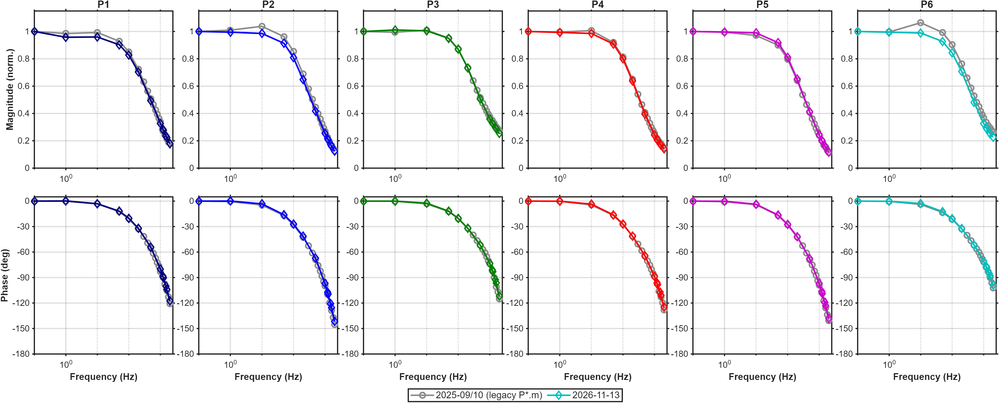
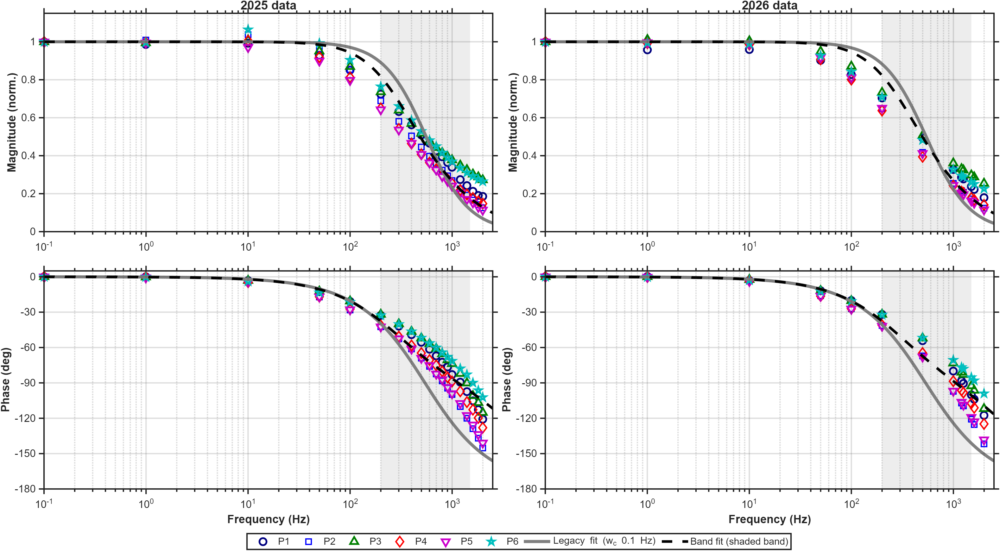

# Open-loop plant fit: 2025 vs 2026 data, legacy vs band method

Generated by `compare_fit_methods.m` (2026-11-13 14:01).

- **2025**: `legacy/P1..P6.m`, DA 2 V, recorded 2025-09-15/16 and 2025-10-03 (raw files on the WD_BLACK drive `F:\P1..P6`). This is the data behind the current R controller model.
- **2026**: PT3D_SW FreqSweep, open loop, DA 2 V, 2026-11-13, HSData V8, 100 kHz (`results/PT3D_OL_2V_20261113/processed/`).
- **legacy** method: `fit_mimo_tf`, p 0.5, wc 0.1 Hz (all 36 curves, shared A1/A2). **band** method: `fit_mimo_band`, B = |H(0.1 Hz)|, A1/A2 over 200-1500 Hz on the 6 diagonal curves.
- Both use the same `step_mimo_fit` preprocessing: auto 180 deg correction, phase offset removed at 0.1 Hz. Continuous model G(s) = A2/(s^2 + A1 s + A2), H = G B; discrete = ZOH at T = 1e-5 s: H(z) = k_o (z^-1 + b z^-2)/(1 - a1 z^-1 - a2 z^-2).
- Frequency sets: **all** = every point up to 2000 Hz; **common** = the 11 frequencies both sweeps have.

## Transfer functions

| data | freq set | method | A1 | A2 | poles (Hz) | k_o | b | a1 | a2 | B diag |
|---|---|---|---|---|---|---|---|---|---|---|
| 2025 | all (19) | legacy | 6616.7 | 1.1591e+07 | 526.5 ± 127.9j | 5.6691e-04 | 0.9782 | 1.934853 | -0.935974 | [0.2365 0.2818 0.2108 0.2361 0.2572 0.1845] |
| 2025 | all (19) | band | 31067.8 | 5.2091e+07 | 283.1, 4661.5 | 2.3535e-03 | 0.9017 | 1.728474 | -0.732950 | [0.2371 0.2815 0.2109 0.2364 0.2577 0.1845] |
| 2025 | common (11) | legacy | 6054.4 | 1.0198e+07 | 481.8 ± 161.9j | 4.9974e-04 | 0.9800 | 1.940263 | -0.941252 | [0.2365 0.2819 0.2108 0.2362 0.2573 0.1845] |
| 2025 | common (11) | band | 28959.7 | 4.8593e+07 | 284.6, 4324.4 | 2.2103e-03 | 0.9080 | 1.744348 | -0.748565 | [0.2371 0.2815 0.2109 0.2364 0.2577 0.1845] |
| 2026 | all (13) | legacy | 6608.2 | 1.1253e+07 | 525.9 ± 92.3j | 5.5042e-04 | 0.9782 | 1.934965 | -0.936054 | [0.2306 0.2673 0.188 0.2212 0.2489 0.1712] |
| 2026 | all (13) | band | 25731.6 | 4.3597e+07 | 290.2, 3805.1 | 2.0036e-03 | 0.9178 | 1.769281 | -0.773124 | [0.232 0.2676 0.1878 0.2216 0.2492 0.1714] |
| 2026 | common (11) | legacy | 5628.9 | 9.1887e+06 | 447.9 ± 179.2j | 4.5090e-04 | 0.9814 | 1.944372 | -0.945266 | [0.2306 0.2673 0.188 0.2212 0.2489 0.1712] |
| 2026 | common (11) | band | 34829.7 | 5.6748e+07 | 272.7, 5270.6 | 2.5336e-03 | 0.8905 | 1.701100 | -0.705889 | [0.232 0.2676 0.1878 0.2216 0.2492 0.1714] |

(Current R controller constants, PT3D_SW before 2026-11-13: k_o 5.6695e-4, b 0.9782, a1 1.934848, a2 -0.935970 = legacy fit of the 2025 data.)

## Fit error (complex relative error |G/Hn - 1|, mean of the 6 diagonal curves)

| data | freq set | method | 100 Hz | 200 Hz | 500 Hz | 1000 Hz | 1600 Hz | 2000 Hz |
|---|---|---|---|---|---|---|---|---|
| 2025 | all | legacy | 17% | 30% | 53% | 61% | 62% | 64% |
| 2025 | all | band | 14% | 20% | 20% | 25% | 40% | 53% |
| 2025 | common | legacy | 17% | 30% | 57% | 65% | 67% | 68% |
| 2025 | common | band | 14% | 20% | 21% | 24% | 39% | 52% |
| 2026 | all | legacy | 19% | 33% | 56% | 63% | 64% | 65% |
| 2026 | all | band | 16% | 23% | 24% | 23% | 34% | 44% |
| 2026 | common | legacy | 19% | 34% | 63% | 71% | 71% | 72% |
| 2026 | common | band | 15% | 21% | 21% | 23% | 38% | 50% |

## B matrix (B_modified, legacy method, all points)

2025:
```
0.2365   -0.0064   -0.0327   -0.0344   -0.0408   -0.0343
   -0.0037    0.2818   -0.0427   -0.0675   -0.0779   -0.0368
   -0.0375   -0.0328    0.2108   -0.0060   -0.0265   -0.0341
   -0.0245   -0.0777   -0.0056    0.2361   -0.0770   -0.0241
   -0.0413   -0.0760   -0.0234   -0.0720    0.2572   -0.0045
   -0.0244   -0.0330   -0.0257   -0.0245   -0.0030    0.1845
```
2026:
```
0.2306   -0.0038   -0.0387   -0.0261   -0.0389   -0.0325
   -0.0041    0.2673   -0.0329   -0.0656   -0.0776   -0.0304
   -0.0381   -0.0266    0.1880   -0.0037   -0.0201   -0.0353
   -0.0212   -0.0829   -0.0036    0.2212   -0.0719   -0.0189
   -0.0365   -0.0807   -0.0187   -0.0717    0.2489   -0.0038
   -0.0268   -0.0266   -0.0280   -0.0198   -0.0009    0.1712
```

## Figures




